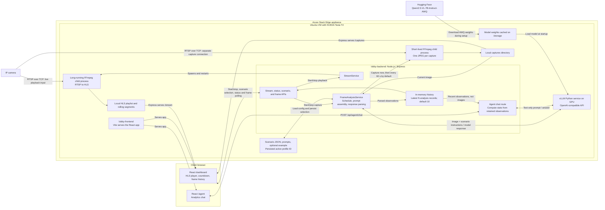

# Architecture

How the system works, why it is built this way, and what it supports. For setup see [README.md](README.md); for edge deployment see [DEPLOYMENT.md](DEPLOYMENT.md); for running and recovery see [OPERATIONS.md](OPERATIONS.md).

## Data flow

The diagram shows the documented Azure Stack Edge deployment (`MODEL_MODE=edge`). In cloud mode the frame analysis caller targets Azure OpenAI instead of vLLM (see [Inference modes](#inference-modes)); the agent chat route always targets vLLM.

Three services run on the VM as systemd user services: `lobby-frontend` (Vite), `lobby-backend` (Node.js/Express, which spawns the FFmpeg children) and `vllm` (Python). The model is not bundled with the Node app; vLLM loads weights cached under `/storage`. In-memory data (history) is lost on a backend restart; disk data (HLS files, JPEGs, `.active-scenario.json`) is on the VM filesystem.

### Tracing the three paths

**Live playback (owner: `StreamService`).**
`POST /api/stream/start` makes `StreamService` spawn one long-running FFmpeg child that reads the camera over RTSP/TCP and writes an HLS playlist and rolling segments to `backend/stream/`. Express serves them under `/stream`; the browser plays them with hls.js (or native HLS). `StreamService` restarts the child if it fails (see [Failure behaviour](#failure-behaviour)). Inference is kept off this path so a slow model never stalls video.

**One sampled frame (owner: `FrameAnalysisService`).**
The same start request calls `startCapture`, which captures immediately and then every `FRAME_CAPTURE_INTERVAL` (60 s default). Each cycle:
1. If the stream is not running, the cycle is skipped and resumes when the stream is back. The backend sets `nextCaptureAt`; the browser only displays it (status polled every 5 s, countdown updated locally every second) and never triggers capture. Stream restarts are retried every 5 s up to 10 times, after which auto-restart stops and capture stays idle until the stream is started again; 5 consecutive failed stills also stop the capture timer.
2. A separate short-lived FFmpeg process opens its own RTSP connection and writes one JPEG to `backend/captures/`. It does not sample the browser player or the HLS output.
3. In edge mode, `GET {SLM_URL}/health` is checked first. If vLLM is unavailable the frame is skipped and retried next cycle; nothing is stored.
4. The JPEG (base64) and the active scenario's edge prompt (falling back to the standard prompt), plus the first configured image/response example if one exists, are sent to `POST {SLM_URL}/v1/chat/completions` with `VLLM_MODEL`.
5. The backend parses and normalizes the reply (JSON, partial JSON or text), applies the scenario alert rules from `scenario-config.json`, and prepends the observation to the in-memory list.
6. While streaming, the dashboard polls `/api/analysis/frames` every 10 s and renders metrics, captions and alerts, loading images from `/captures`.

Retention: the in-memory records are capped at `MAX_ANALYZED_FRAMES` (default 10). When exceeded, the oldest record is evicted and its JPEG deleted, so disk normally holds about the same number of stills. After a backend restart the records are gone and leftover `frame_*.jpg` files are deleted at startup; the active scenario ID survives. Switching scenario clears the in-memory records (JPEGs stay on disk until the next restart).

**One chat request (owner: the agent route).**
`/agent` sends `POST /api/agent/chat`. The route computes queue statistics, token observations and alert totals in Node from the retained records, then sends a text-only prompt to the same vLLM endpoint and model (`SLM_URL`, `VLLM_MODEL`). It never sends images, does not reanalyze frames and does not query a historical database, so time windows are limited to the retained observations. Its prompt is written for the Government Service Center scenario.

### Scenario selection

At startup the backend uses the saved profile (`backend/.active-scenario.json`), else `PROMPT_PROFILE`, else `hub-lobby-default`. Switching reloads the scenario JSON, prompts and example, clears history and persists the new ID. See [Scenario profiles](#scenario-profiles).

### Edge model prerequisites

Before deploying the app the VM needs a visible Tesla T4, a compatible NVIDIA driver and CUDA toolkit, a Python/Conda environment with vLLM on `/storage`, and the downloaded Hugging Face weights. The commands, GPU memory and context settings (`--gpu-memory-utilization`, `--max-model-len`), systemd user services with linger, `MODEL_MODE`, `SLM_URL`, `VLLM_MODEL`, and health and image-inference checks are in [DEPLOYMENT.md](DEPLOYMENT.md), the single authoritative procedure; they are not repeated here. See also [Inference modes](#inference-modes) for why a 4-bit AWQ Qwen2.5-VL is used on the T4.

## Components

| Component | File | Responsibility |
|---|---|---|
| Express app | `backend/server.js` | Serves `/stream` (HLS, no-cache headers, `.m3u8`/`.ts` MIME types) and `/captures` (JPEGs), mounts the API routers, exposes `GET /health`. Loads the repo-root `.env`. |
| Stream service | `backend/services/streamService.js` | Spawns FFmpeg to transcode RTSP (TCP transport) to HLS and restarts it on failure. |
| Frame analysis service | `backend/services/frameAnalysisService.js` | Schedules stills, calls the model, parses the answer, applies scenario alert rules, holds recent observations, owns scenario and model-mode state. |
| Routes | `backend/routes/{stream,analysis,agent}.js` | Thin HTTP layer over the two services. |
| Dashboard | `frontend/src/components/LobbyDashboard.jsx` | Player, controls, metrics, alert dialog, frame gallery, scenario and model-mode switches. |
| Agent page | `frontend/src/components/AgentChat.jsx` | Served by the same frontend at path `/agent`. |

The two FFmpeg processes are deliberately independent. A slow or failed inference never stalls video, and a stalled HLS encode does not corrupt stills. The cost is two RTSP connections to the camera; check that your camera permits that.

### Stream pipeline

- FFmpeg re-encodes to H.264 (`libx264`, `ultrafast`, `zerolatency`, 2500 kbps CBR, 30 fps, GOP 60) and AAC, writing 2-second HLS segments with a 10-segment playlist and `delete_segments`. Old segments are removed by FFmpeg; nothing else prunes `backend/stream/`.
- Re-encoding (rather than `-c copy`) is what makes arbitrary camera codecs playable in browsers.
- The dashboard plays with hls.js, `lowLatencyMode: false`, staying 4 segments behind the live edge with generous buffers.

### Analysis pipeline

1. A timer fires every `FRAME_CAPTURE_INTERVAL` ms. A capture is skipped while the HLS stream is not running.
2. FFmpeg writes `backend/captures/frame_<timestamp>.jpg` (single frame from RTSP, not from HLS).
3. The image goes to the active inference backend (see [Inference modes](#inference-modes)).
4. The response is parsed (JSON, partial JSON, or markdown, depending on prompt and model), alert rules from `scenario-config.json` are applied, and the observation is prepended to the in-memory list. When the list exceeds `MAX_ANALYZED_FRAMES`, the oldest entry is dropped and its JPEG deleted.

## Design decisions and trade-offs

| Decision | Why | Cost |
|---|---|---|
| HLS instead of WebRTC | Plain HTTP, works through proxies, no signalling or TURN, hls.js handles reconnects. Static file serving is enough. | Several seconds of end-to-end latency (2 s segments plus a player buffer of about 4 segments). Not suitable for sub-second control. |
| Polling instead of WebSockets | Observations arrive once per interval, so push adds little. Simple and stateless. | Frames are polled every 10 s and status every 5 s, so a new observation can appear up to about 10 s after it is stored. |
| Server-side sampling from RTSP | Inference stays independent of any browser; stills are full quality and not tied to the HLS encode. | Second RTSP session; the still can differ from what the viewer sees by the HLS delay. |
| Shared capture countdown | The backend records `nextCaptureAt` (epoch ms) and returns it in `/api/stream/status`. Every browser computes the countdown from that timestamp, so all clients agree. | Depends on client clocks being roughly correct. The countdown is for display; it does not trigger captures. |
| In-memory observation list | No database to run; fits the "latest N" use. | Observations are lost on backend restart. |
| Frames on disk, capped | Browsers load JPEGs from `/captures`. | At most `MAX_ANALYZED_FRAMES` stills in normal operation. Leftover `frame_*.jpg` files are deleted at backend startup. Switching scenario clears the in-memory list but does not delete the JPEGs, so they remain until the next backend restart. |
| Scenario packs as files | Adding a scenario is a folder, not a code change. | Alert rules are interpreted by shared code, so new rule types still need code. |
| Separate edge prompt | Small models need shorter, stricter prompts than GPT-4-class models. | Two prompts per scenario to keep in step. |

### Failure behaviour

| Failure | What happens |
|---|---|
| FFmpeg HLS process exits with a non-zero code or logged errors | `streamService` retries every 5 s, up to 10 attempts. After that auto-restart is disabled and the stream must be started again from the dashboard. A manual Stop never auto-restarts. |
| Stream is down when a capture is due | The capture is skipped; captures resume once the stream is back. |
| A still cannot be captured | Counted; after 5 consecutive failures the capture timer stops (stream status is unaffected). Starting the stream again restarts capture. |
| vLLM health check (`GET {SLM_URL}/health`, 5 s timeout) fails | The frame is not stored; the next cycle tries again. The dashboard shows the edge model as "Recovering...". |
| vLLM request exceeds 120 s, or returns an error | The frame is discarded and its JPEG deleted. |
| Model refuses ("cannot view images") | Retried once; if refused again the frame is dropped. |
| Azure OpenAI call fails | The frame is discarded. |
| Azure OpenAI not configured (`AZURE_OPENAI_ENDPOINT` unset) | A "not configured" message is stored as the observation text instead of being discarded. |
| Browser loses the backend | The player retries; status polling updates the UI when the backend returns. |

There is **no automatic failover between cloud and edge**. The mode is whatever `MODEL_MODE` or the dashboard selector last set. If the active backend is down, analysis stops producing observations until it recovers or someone switches mode.

A backend restart loses the running stream (it must be started again), the in-memory observations, and any runtime model-mode or URL change. It keeps the active scenario (`backend/.active-scenario.json`).

## Inference modes

| | Cloud | Edge |
|---|---|---|
| Backend | Azure OpenAI chat completions (`@azure/openai`) | vLLM OpenAI-compatible `/v1/chat/completions` |
| Config | `AZURE_OPENAI_ENDPOINT`, optional `AZURE_OPENAI_API_KEY` (else `DefaultAzureCredential`), `AZURE_OPENAI_DEPLOYMENT_NAME` | `SLM_URL`, `VLLM_MODEL` |
| Prompt | `analysis-prompt.txt` | `analysis-prompt-edge.txt` (falls back to `analysis-prompt.txt`) |
| Few-shot example | Not used | First `one-shot-*` image/response pair, sent as a prior user/assistant turn |
| Sampling | `maxTokens` 1000, temperature 0.3 | `max_tokens` 450, temperature 0.4 |
| Pre-check | None | `/health` before every frame |
| Frames leave the site | Yes, sent to Azure OpenAI | No, stay on the local network |
| Hardware | None | GPU host, see [DEPLOYMENT.md](DEPLOYMENT.md) |

- **Model identity**: the code default for `VLLM_MODEL` is `microsoft/Phi-4-multimodal-instruct`. The documented, deployed edge model is `Qwen/Qwen2.5-VL-7B-Instruct-AWQ` and must be set explicitly in `.env`. The dashboard shows the configured model name.
- **Switching**: `POST /api/analysis/model-mode` (also the dashboard toggle) changes mode and optionally `SLM_URL` at runtime. This is not persisted; after a restart the `.env` values apply.
- **Agent**: `/agent` always talks to the vLLM server at `SLM_URL`, regardless of `MODEL_MODE`. It needs vLLM running even when analysis uses Azure OpenAI.
- **Why a 4-bit AWQ Qwen model on the edge**: a 7B vision model in float16 does not leave useful headroom on a 15 GB T4; the AWQ build from Hugging Face uses about 6.6 GB. It replaced an earlier Phi-4-multimodal deployment because it followed the JSON format more reliably and produced fewer false alert detections on CCTV footage. Details in [DEPLOYMENT.md](DEPLOYMENT.md).

## Scenario profiles

Each scenario is a folder under `backend/system-prompts/<id>/`:

| File | Purpose |
|---|---|
| `scenario-config.json` | Display name, metric tiles (`metrics`, `totalMetric`), scene sections, alert definition. Drives the dashboard. |
| `analysis-prompt.txt` | Prompt for cloud mode (and fallback for edge). |
| `analysis-prompt-edge.txt` | Prompt for edge mode. |
| `one-shot-image.jpg` + `one-shot-response.json` (optional; `one-shot-2-*`, ...) | Example used to ground the edge model. The loader reads up to ten pairs but only the first is sent. |

Any folder with a valid `scenario-config.json` appears in `GET /api/analysis/scenarios` and in the dashboard selector.

| | Innovation Hub Lobby (`hub-lobby-default`) | AI First Bank (`ai-first-bank`) | Government Service Center (`gov-service-center`) |
|---|---|---|---|
| Focus | Visitor and reception activity | Seating area: children, people who may need assistance, waiting customers | Service queue, token display, crowding, fallen person |
| Metrics | Near doors, at reception, other areas, total visible | Children, person needing assistance, waiting customers, total | Queue length, current token |
| Alerts | None configured | Single alert (`Branch Manager Alert`) when `children_detected` or `persons_needing_assistance` is non-zero | Green "Queue Crowding" when `queue_count` exceeds `GOV_QUEUE_THRESHOLD` (default 5); red "Emergency" when `person_fallen` is true |
| Few-shot examples | none | none | two image/response pairs (first is used) |
| Metric tiles in edge mode | Hidden | Hidden | Shown (`edgeMetricsAvailable: true`) |

### Alerts: what they do and do not do

- An alert is raised when the parsed model output meets the scenario's trigger rule and carries an `alert_message`. The dashboard shows a dialog and marks the observation in the gallery.
- The red government alert lists suggested response actions. Picking one is recorded **in the browser only**; nothing is dispatched.
- Some alert text (for example the AI First Bank message) says that an email notification was sent to the Branch Manager. This is copy from the scenario configuration and prompt-handling code. **There is no email integration**; no code sends mail.

### Switching and persistence

`POST /api/analysis/scenarios/switch {"scenarioId": "<id>"}` reloads the prompts, config and examples, clears the in-memory observation list, and writes `backend/.active-scenario.json`. On startup the backend uses that file if present and valid; otherwise `PROMPT_PROFILE`; otherwise `hub-lobby-default`. Delete the file to fall back to `PROMPT_PROFILE`.

### Analytics agent

`POST /api/agent/chat` builds a summary from the observations currently held in memory (at most `MAX_ANALYZED_FRAMES`, about ten minutes at the default settings): latest values, 5-minute, 10-minute and all-retained queue statistics, token numbers seen, and green/red alert counts. It sends that summary with the question and the last 10 history messages to vLLM (`max_tokens` 500, temperature 0.3, 90 s timeout). Answers are limited to that window. The summary and system prompt are written for the government service center scenario, so under the other scenarios the queue and token figures are `N/A`.

## API reference

Base URL is the backend (`http://<host>:3001`). Bodies are JSON. API responses carry `success`.

| Method | Path | Purpose |
|---|---|---|
| GET | `/health` | `{status:"ok"}` liveness of the Node process |
| POST | `/api/stream/start` | Body `{rtspUrl}`. Starts HLS and still capture. 400 if missing |
| POST | `/api/stream/stop` | Stops both |
| GET | `/api/stream/status` | `stream` (isStreaming, streamUrl, restartAttempts, ...) and `capture` (isCapturing, frameCount, modelMode, deploymentName, slmUrl, slmHealthy, failedCaptureCount, activeScenario, scenarioConfig, nextCaptureAt, captureIntervalMs). Also refreshes the edge health flag |
| GET | `/api/analysis/frames` | Retained observations, newest first, with `count` |
| GET | `/api/analysis/frames/:id` | One observation; 404 if not retained |
| GET | `/api/analysis/scenarios` | Available scenarios and which is active |
| GET | `/api/analysis/scenarios/active` | Active scenario config |
| POST | `/api/analysis/scenarios/switch` | Body `{scenarioId}` |
| GET | `/api/analysis/model-mode` | `{mode, slmUrl, cloudDeployment}` |
| POST | `/api/analysis/model-mode` | Body `{mode: "cloud"|"edge", slmUrl?}` |
| POST | `/api/agent/chat` | Body `{question, history?}` -> `{answer, framesAnalyzed}` |
| GET | `/stream/stream.m3u8`, `/stream/segment<N>.ts` | HLS playlist and segments |
| GET | `/captures/frame_<ts>.jpg` | Retained stills |

## Security posture

No authentication, open CORS, HTTP only, and `POST /api/stream/start` accepts any RTSP URL and passes it to FFmpeg. Run on a trusted network, restrict who can reach ports 3001 and 5173, and add TLS and access control in front of it if exposed. RTSP credentials live in the URL, and the status endpoint returns the active `rtspUrl`.
